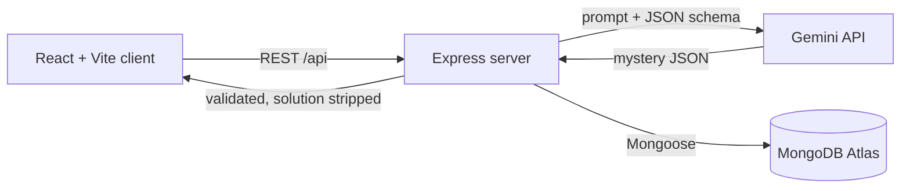

# AI Mystery Room

Describe a mystery and Gemini writes the case. Question the suspects, examine clues, ask for hints, then name the culprit. The solution stays on the server until you accuse. Full blueprint: [SPEC.md](./SPEC.md).

**Live app:** https://claude.ai/artifact/3yzJ9w4s3GFpMww5WJPGx5

## Features
- Gemini generates a complete, validated whodunit at three difficulty levels (3 / 4 / 5 suspects).
- **Interrogate suspects** with an AI that stays in character. The guilty one lies, the innocent ones don't know who did it.
- Examine clues one by one, request hints, mark suspects as suspicious or cleared.
- One accusation per case, then a verdict, explanation, supporting clues, score and detective rank.
- Backend-calculated scoring, a local case history, and a "same premise, new case" replay.
- Secure by design: solution hidden by default in the database, rate limiting, input validation, secrets only on the server.

## How it works


## Stack
React, Vite, Tailwind CSS, React Router, Axios, Node.js, Express, MongoDB (Mongoose), Zod, Gemini API.

## Setup
Requires Node 18+, a MongoDB Atlas connection string and a [Gemini API key](https://aistudio.google.com/apikey).

```bash
# backend
cd server
npm install
cp .env.example .env     # fill in MONGODB_URI and GEMINI_API_KEY
npm run dev              # http://localhost:5000
npm test                 # scoring unit tests

# frontend (new terminal)
cd client
npm install
cp .env.example .env     # VITE_API_URL=http://localhost:5000/api
npm run dev              # http://localhost:5173
```

## API
| Method and path | Purpose |
|---|---|
| `POST /api/cases` | Generate a mystery |
| `GET /api/cases/:id` | Get an active mystery (no solution) |
| `POST /api/cases/:id/clues/:clueId/discover` | Reveal a clue |
| `POST /api/cases/:id/hints` | Use a hint |
| `POST /api/cases/:id/interrogate` | Ask a suspect a question |
| `POST /api/cases/:id/accuse` | Submit the accusation |
| `GET /api/cases/:id/result` | Verdict (only after accusing) |

## Scoring
Correct accusation: Easy 100, Medium 150, Hard 200. +5 per clue found, -10 per hint used, minimum 0.

## Deploy
1. **Database:** free MongoDB Atlas cluster, network access `0.0.0.0/0`.
2. **Backend (Render):** root directory `server`, build `npm install`, start `npm start`. Env vars: `MONGODB_URI`, `GEMINI_API_KEY`, `CLIENT_URL` (your Vercel URL).
3. **Frontend (Vercel):** root directory `client`, framework Vite. Env var: `VITE_API_URL=https://<your-render-app>.onrender.com/api`.
4. Set `CLIENT_URL` on Render to the final Vercel URL and redeploy.

## Security
API keys stay in `server/.env` (git-ignored). The culprit and explanation are never sent before an accusation, and innocent suspects' AI prompts never contain the solution.
